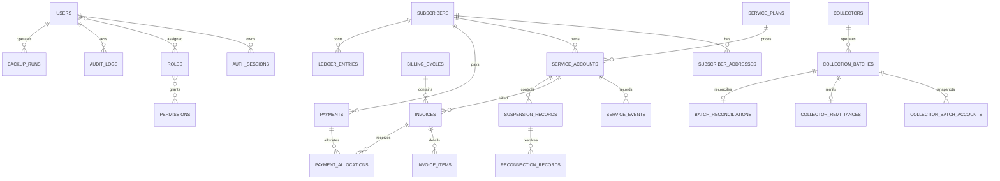

# BCIS ERD and Data Dictionary

## Table groups

| Group | Main tables | Purpose |
|---|---|---|
| Security | `users`, `roles`, `permissions`, `user_roles`, `role_permissions`, `auth_sessions`, `login_attempts`, `audit_logs` | Authentication, RBAC, and immutable actor history. |
| Subscriber/service | `subscribers`, addresses/contacts, `service_types`, `service_plans`, `service_accounts`, `service_events` | Customer identity and subscription lifecycle. |
| Billing | `billing_cycles`, `invoices`, `invoice_items`, `billing_idempotency` | Monthly charge generation and immutable invoice snapshots. |
| Payment/ledger | `payments`, `payment_allocations`, `receipts`, `payment_reversals`, `ledger_entries` | Cash posting, allocation, receipt, compensation, and SOA source. |
| Collections | areas/routes/collectors/assignments, batch/account/entry/remittance/reconciliation tables | Route snapshots and cash accountability. |
| Service control | `suspension_records`, `reconnection_records` | Request, independent approval, completion, and financial linkage. |
| Recovery | `backup_runs` | Backup status, checksum, financial snapshot, and restore actor/time. |

All authoritative money columns use centavos. Foreign keys use `restrict` for historical records; partial unique indexes prevent duplicate active assignments or service-control requests.
